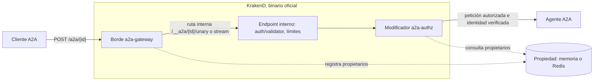

# Plugin A2A para KrakenD

[](COPYING)


Soporte nativo del protocolo **Agent2Agent (A2A)** en el API gateway **KrakenD**, para Community 2.13.11 y Enterprise 3.0.4, con un único código fuente.

Publica tus agentes A2A detrás de KrakenD con descubrimiento, autenticación, scopes por operación y control de quién es propietario de cada tarea. No hace falta modificar el binario de KrakenD ni los agentes.

**Versión 0.1.0.** Licencia MIT: puedes usarlo, modificarlo y hacer forks libremente.

La guía del plugin, con la instalación paso a paso en cada edición, ejemplos de uso y los códigos de error, está en [a2a-plugin/README.md](a2a-plugin/README.md).

## Contenido

- [Por qué](#por-qué)
- [Características](#características)
- [Qué soporta](#qué-soporta)
- [Cómo funciona](#cómo-funciona)
- [Inicio rápido](#inicio-rápido)
- [Instalación en tu KrakenD](#instalación-en-tu-krakend)
- [Configuración](#configuración)
- [Seguridad](#seguridad)
- [Calidad y pruebas](#calidad-y-pruebas)
- [Estructura del repositorio](#estructura-del-repositorio)
- [Limitaciones conocidas](#limitaciones-conocidas)
- [Contribuir](#contribuir)
- [Licencia](#licencia)

## Por qué

A2A usa JSON-RPC 2.0 sobre HTTP. Todas las operaciones de un agente llegan al mismo endpoint con `POST`; lo que distingue `SendMessage` de `CancelTask` es el campo `method` del cuerpo.

Un gateway que solo mira el método y la ruta HTTP tiene tres problemas con A2A:

- No puede aplicar políticas por operación.
- No sabe qué usuario creó cada tarea, así que cualquiera con un token válido puede leer o cancelar las tareas de otro.
- Publica las Agent Cards con las URLs internas de los agentes.

El plugin enseña A2A a KrakenD. Entiende el protocolo y encamina cada operación por el pipeline nativo de KrakenD, con su autenticación, sus límites y su telemetría. Además añade lo que A2A necesita y KrakenD no trae: reescritura de Agent Cards, scopes por operación y propiedad de tareas y contextos.

## Características

### Descubrimiento

- **Rutas de la Agent Card.** Publica la card de cada agente en `/a2a/{id}/.well-known/agent-card.json`. La del agente por defecto se publica también en `/.well-known/agent-card.json`.
- **Solo URLs del gateway.** Reescribe la card para que anuncie únicamente el gateway. Elimina las URLs internas del agente, también las de campos como `documentationUrl`.
- **Seguridad y capacidades del gateway.** Sustituye los esquemas de seguridad del agente por los del gateway. Solo anuncia las capacidades que el gateway tiene habilitadas.
- **Origen de la card.**
  - `upstream`: la obtiene del agente, con caché, `ETag` y `Cache-Control`. Si el agente no responde, sirve la última copia válida.
  - `static`: la publica desde la configuración o desde un fichero.
- **Firmas.** Verifica la firma JWS de la card remota con un JWKS de confianza. Admite Ed25519, ECDSA y RSA, con canonicalización JCS.
- **Formas 0.3 y 1.0.** Acepta cards de agentes en cualquiera de las dos formas.
- **Metadatos de recurso protegido.** Publica los de cada agente según el RFC 9728, para que los clientes descubran el servidor de autorización.

### Pasarela de protocolo

- **Validación del sobre JSON-RPC 2.0.** Antes de que la petición llegue a KrakenD, el plugin exige:
  - UTF-8 válido y JSON bien formado.
  - Un tamaño máximo.
  - Ninguna clave repetida, tampoco las que solo difieren en mayúsculas.
- **Versión.** La negocia con la cabecera `A2A-Version`. Una petición sin la cabecera se atiende como 0.3.
- **Operaciones.** Entiende las once operaciones de A2A 1.0 y los diez métodos de 0.3. Las encamina a rutas internas de KrakenD por clase (`unary` o `stream`) o por operación.
- **Streaming SSE incremental.** Hace flush en cada evento, también en Community, que de serie entrega el flujo entero al final.
- **Recortes por agente.** Permite desactivar operaciones (`disabled_operations`) y capacidades (`streaming`, `push_notifications`).
- **Errores.** Responde con los códigos de error JSON-RPC de A2A.

### Seguridad y control de acceso

- **Autenticación.** Reutiliza la de KrakenD (`auth/validator` con JWT, JWKS y revocación) y lee la identidad que KrakenD propaga con `propagate_claims`.
- **Sin suplantación.** Borra de toda petición entrante las cabeceras de identidad y las `X-A2A-*`, así que un cliente no puede hacerse pasar por otro.
- **Scopes por operación.** Por ejemplo, exigir `a2a.write` para `CancelTask`.
- **Propiedad de tareas y contextos.**
  - Quien crea una tarea o un contexto queda registrado como propietario.
  - Los demás reciben `-32001 Task not found`, igual que si no existiera.
  - El registro vive en memoria, para un nodo, o en Redis, para varios nodos. Redis admite TTL, credenciales leídas de variables de entorno y TLS.
- **Guardia de webhooks.** Revisa la URL de las notificaciones push antes de que llegue al agente. Exige HTTPS y respeta una lista de hosts permitidos. Bloquea loopback, redes privadas, link-local, metadatos de nube y rangos reservados, también después de resolver el nombre.
- **Fallo cerrado.** Si falta la identidad, falta el modificador de autorización o el almacén no responde, el plugin deniega.
- **Respuestas 401.** Llevan `WWW-Authenticate` y, si se activa, `resource_metadata` (RFC 9728).
- **Lo que recibe el agente.** La identidad verificada, nunca el token del cliente.
- **Registros.** Nunca registran el cuerpo, el token ni el sujeto en claro.

### Operación y empaquetado

- **Un código para las dos ediciones.** El núcleo solo usa la biblioteca estándar de Go.
- **Validación estricta al arrancar.** Comprueba campos desconocidos, valores `null`, rangos y reglas entre campos. Con un solo error KrakenD no arranca, y el mensaje lista todos los errores con la ruta de cada campo.
- **Esquema JSON del bloque de configuración.** Sirve para validar en el editor o en la integración continua.
- **Plantillas de Flexible Config.** Generan la configuración completa de cada edición a partir de una lista de agentes.
- **Artefacto por edición.**
  - Lleva un manifiesto con la edición, la versión de KrakenD, Go, libc, la arquitectura y el sha256.
  - Un script rechaza un `.so` incompatible antes de desplegarlo.
- **Componentes nativos.** Los endpoints internos admiten los de KrakenD, como el límite de peticiones.

## Qué soporta

### Ediciones de KrakenD

| Edición | Versión verificada | Go | Imagen de compilación | Notas |
|---|---|---|---|---|
| Community | 2.13.11 | 1.26.8 | `krakend/builder:2.13.11` | Última Community que carga plugins Go. La línea no recibe correcciones de seguridad desde el 8 de septiembre de 2026. |
| Enterprise | 3.0.4 o superior | 1.27.4 | `krakend/builder-ee:3.0.4` | Con soporte. Evita 3.0.0 a 3.0.3, que tienen un fallo en los modificadores. Requiere una licencia de Enterprise, que este repositorio no incluye. |

Cada artefacto solo carga en la edición, la versión de KrakenD, el Go y la libc exactos de su manifiesto.

### Protocolo A2A

| Versión | Binding | Estado |
|---|---|---|
| 1.0 | JSON-RPC | Completo: las once operaciones |
| 0.3 | JSON-RPC | Completo: los diez métodos |
| 1.0 y 0.3 | HTTP+JSON, gRPC | No soportados |

### Operaciones

| A2A 1.0 | A2A 0.3 | Ruta interna |
|---|---|---|
| `SendMessage` | `message/send` | `unary` |
| `SendStreamingMessage` | `message/stream` | `stream` |
| `GetTask` | `tasks/get` | `unary` |
| `ListTasks` | No existe en 0.3 | `unary` |
| `CancelTask` | `tasks/cancel` | `unary` |
| `SubscribeToTask` | `tasks/resubscribe` | `stream` |
| `CreateTaskPushNotificationConfig` | `tasks/pushNotificationConfig/set` | `unary` |
| `GetTaskPushNotificationConfig` | `tasks/pushNotificationConfig/get` | `unary` |
| `ListTaskPushNotificationConfigs` | `tasks/pushNotificationConfig/list` | `unary` |
| `DeleteTaskPushNotificationConfig` | `tasks/pushNotificationConfig/delete` | `unary` |
| `GetExtendedAgentCard` | `agent/getAuthenticatedExtendedCard` | `unary` |

Las cuatro operaciones de notificaciones push están desactivadas por defecto, porque permiten al cliente elegir a qué destino llama el agente.

### Interoperabilidad verificada

| Componente | Versión |
|---|---|
| SDK oficial de A2A para Go, como cliente y como agente, en 1.0 y 0.3 | `github.com/a2aproject/a2a-go/v2` v2.8.0 |
| Firma de Agent Cards del SDK | `a2acrypto`, ES256 |
| Agentes de Pydantic AI servidos con FastA2A | FastA2A 2.1.1, Pydantic AI 2.68 |
| Redis para compartir la propiedad entre nodos | 7.4 |

## Cómo funciona

El plugin es un único `.so` con dos componentes que KrakenD carga sin modificar su binario:

| Componente | Tipo de plugin de KrakenD | Función |
|---|---|---|
| `a2a-gateway` | Servidor HTTP, `plugin/http-server` | El borde: publica las cards, valida y encamina las peticiones A2A y procesa las respuestas. |
| `a2a-authz` | Modificador de petición y respuesta, `plugin/req-resp-modifier` | Autoriza cada operación con la identidad que KrakenD ya verificó. |



Recorrido de una petición:

1. **Borde.**
   - Borra las cabeceras de identidad y las `X-A2A-*`.
   - Valida el sobre JSON-RPC y negocia la versión.
   - Identifica la operación y aplica las operaciones habilitadas y la guardia de webhooks.
   - Encamina la petición a una ruta interna.
2. **Endpoint interno de KrakenD.** La autenticación nativa valida el token y propaga la identidad. Después se aplican los demás componentes configurados, como el límite de peticiones.
3. **Autorización A2A.** El modificador `a2a-authz` comprueba la identidad obligatoria, los scopes de la operación y la propiedad de la tarea o del contexto.
4. **Agente.** Solo recibe peticiones autorizadas, con la identidad verificada en cabeceras y sin el token del cliente.
5. **Borde, en la respuesta.**
   - Registra como propietario a quien creó la tarea o el contexto.
   - Reescribe la card extendida y normaliza los errores.
   - Entrega los eventos SSE según llegan.

Rutas públicas, con los prefijos por defecto:

| Ruta | Método | Qué es |
|---|---|---|
| `/a2a/{id}` | `POST` | Endpoint JSON-RPC del agente |
| `/a2a/{id}/.well-known/agent-card.json` | `GET`, `HEAD` | Agent Card publicada |
| `/.well-known/agent-card.json` | `GET`, `HEAD` | Card del agente por defecto, si se configura `default_agent` |
| `/.well-known/oauth-protected-resource/a2a/{id}` | `GET` | Metadatos de recurso protegido (RFC 9728), si se activan |
| `/__a2a/...` | | Rutas internas. Desde fuera responden 404. |

`base_path` cambia el prefijo `/a2a` e `internal_prefix` cambia `/__a2a`.

## Inicio rápido

Requisitos:

- Docker con Docker Compose.
- Bash. En Windows sirve Git Bash.
- Go 1.26 o superior, solo para las pruebas.

```bash
git clone https://github.com/askenaz/krakend-a2a-plugin.git
cd krakend-a2a-plugin/a2a-plugin
```

### Demostración con Community

```bash
docker compose -f deploy/compose/community.yml up -d --build
```

```bash
bash deploy/demo.sh ce
```

El entorno contiene:

- Dos nodos de KrakenD con el plugin, que comparten Redis.
- Un IdP simulado.
- Dos agentes hechos con el SDK oficial: `billing` y `research`, que firma su card.

`demo.sh` recorre diez pasos:

1. Tokens del IdP.
2. Descubrimiento.
3. `SendMessage` en 1.0.
4. Streaming.
5. Otro usuario no puede leer una tarea ajena.
6. La propiedad se respeta entre los dos nodos.
7. Una petición sin token recibe 401.
8. Un cliente 0.3 funciona.
9. Un webhook hacia la red interna se bloquea.
10. Se verifica la firma de la card.

| Puerto | Servicio |
|---|---|
| 18080 y 18081 | Nodos del gateway |
| 18090 | IdP simulado |
| 18091 y 18092 | Administración de los agentes `billing` y `research` |

El primer arranque genera las claves y los secretos de la demostración en `deploy/.secrets`, que git excluye. Para rotarlos, borra ese directorio y vuelve a levantar el entorno.

Para detenerlo:

```bash
docker compose -f deploy/compose/community.yml down
```

### Demostración con Enterprise

Necesitas tu propia licencia de KrakenD Enterprise. Se monta en modo lectura desde una ruta fuera del repositorio:

```bash
KRAKEND_EE_LICENSE_FILE=/ruta/fuera/del/repo/LICENSE docker compose -f deploy/compose/enterprise.yml up -d --build
```

```bash
bash deploy/demo.sh ee
```

Usa los puertos 28080 a 28092. Nunca copies la licencia al repositorio ni a una imagen. Los registros de Enterprise incluyen líneas sobre la licencia, así que fíltralos antes de compartirlos.

### Dos agentes de Pydantic AI que hablan A2A a través del gateway

```bash
cd demos/pydantic-ai
docker compose up -d --build
docker compose run --rm pruebas
```

- Un agente coordinador atiende al cliente y consulta a un agente de soporte por A2A, en streaming. Esa consulta también pasa por el gateway, con su propio token.
- Las pruebas hacen 27 comprobaciones: descubrimiento, autenticación, propiedad, compatibilidad con 0.3, SSE y la llamada de agente a agente.
- Sin credenciales, los agentes usan un modelo local y determinista. Con `ANTHROPIC_API_KEY` definida usan Claude Opus 5.5.
- Puertos: gateway en 19080 e IdP en 19090.

Detalles en [su README](a2a-plugin/demos/pydantic-ai/README.md).

## Instalación en tu KrakenD

Los comandos se ejecutan desde `a2a-plugin`. Ejemplo con Community; con Enterprise cambian la carpeta `build/` y la imagen.

**1. Construir.** La construcción ejecuta todas las pruebas con el mismo Go que el binario de KrakenD. Después, ya en la imagen oficial de destino, comprueba el artefacto y la carga del plugin. Si algo falla, no se genera la imagen.

```bash
docker build -f build/community/Dockerfile -t krakend-a2a:ce-2.13.11 .
```

```bash
docker build -f build/community/Dockerfile --target artifacts -o type=local,dest=out/community .
```

`out/community` recibe tres ficheros:

- El plugin, `krakend-a2a-ce-2.13.11.so`.
- Su manifiesto.
- `check-artifact.sh`.

**2. Comprobar en la imagen de destino.** Un `.so` de otra edición o versión aborta KrakenD al cargarlo. El script lo detecta antes de desplegar.

```bash
docker run --rm --entrypoint sh -v "$PWD/out/community:/p:ro" krakend:2.13.11 /p/check-artifact.sh /p/krakend-a2a-ce-2.13.11.so
```

**3. Configurar.** Describe tus agentes en `config/templates/settings/a2a.json` y genera la configuración. Las plantillas colocan en cada endpoint interno la autenticación nativa, la propagación de la identidad y el modificador de autorización.

```bash
config/templates/render.sh community https://gw.example.com
```

**4. Arrancar.**

```bash
docker run -p 8080:8080 -v "$PWD/out/rendered-community.json:/etc/krakend/krakend.json:ro" krakend-a2a:ce-2.13.11 run -c /etc/krakend/krakend.json
```

Los comandos de las dos ediciones, la configuración a mano y ejemplos de uso con `curl` y con el SDK oficial están en la [guía del plugin](a2a-plugin/README.md). Las guías por edición son [docs/community.md](a2a-plugin/docs/community.md) y [docs/enterprise.md](a2a-plugin/docs/enterprise.md). La de Enterprise incluye cómo actualizar KrakenD sin romper el plugin.

## Configuración

El bloque A2A es idéntico en las dos ediciones. Lo que cambia es dónde va.

Community 2.13, con `"version": 3`:

```json
{
  "version": 3,
  "plugin": { "pattern": ".so", "folder": "/opt/krakend/plugins/" },
  "extra_config": {
    "plugin/http-server": {
      "name": ["a2a-gateway"],
      "a2a-gateway": { "public_url": "https://gw.example.com", "agents": [] }
    }
  }
}
```

Enterprise 3.0, con `"version": 4`:

```json
{
  "version": 4,
  "extra_config": {
    "plugin": { "pattern": ".so", "folder": "/opt/krakend/plugins/" },
    "plugin/http-server": {
      "plugins": [
        { "name": "a2a-gateway", "config": { "public_url": "https://gw.example.com", "agents": [] } }
      ]
    }
  }
}
```

En las dos ediciones, cada endpoint interno lleva además el modificador `a2a-authz` con el `id` de su agente. Las plantillas lo hacen por ti.

El bloque mínimo publica un agente cuya card se obtiene del propio agente:

```json
{
  "public_url": "https://gw.example.com",
  "agents": [
    {
      "id": "billing",
      "card": { "source": "upstream", "url": "http://billing.internal:8080/.well-known/agent-card.json" }
    }
  ]
}
```

Un bloque más completo, con identidad, scopes, propiedad en Redis, guardia de webhooks y metadatos de recurso protegido:

```json
{
  "public_url": "https://gw.example.com",
  "default_agent": "billing",
  "identity": {
    "required": true,
    "headers": { "issuer": "X-A2A-Iss", "subject": "X-A2A-Sub", "scopes": "X-A2A-Scope" },
    "owner_scope": ["issuer", "subject"]
  },
  "authorization": {
    "operation_scopes": { "GetTask": ["a2a.read"], "CancelTask": ["a2a.write"] }
  },
  "ownership": {
    "store": "redis",
    "ttl": "168h",
    "redis": { "address": "redis.internal:6379", "tls": true, "password_env": "A2A_REDIS_PASSWORD" }
  },
  "push_notifications": { "allowed_hosts": ["*.hooks.example.com"] },
  "challenge": {
    "realm": "agents",
    "resource_metadata": true,
    "authorization_servers": ["https://idp.example.com/realms/agents"],
    "scopes_supported": ["a2a.read", "a2a.write"]
  },
  "agents": [
    {
      "id": "billing",
      "versions": ["1.0", "0.3"],
      "card": { "source": "upstream", "url": "https://billing.internal/.well-known/agent-card.json" },
      "security": {
        "schemes": {
          "oidc": { "openIdConnectSecurityScheme": { "openIdConnectUrl": "https://idp.example.com/realms/agents/.well-known/openid-configuration" } }
        },
        "requirements": [ { "schemes": { "oidc": { "list": ["a2a.read"] } } } ]
      },
      "capabilities": { "streaming": true, "push_notifications": true }
    }
  ]
}
```

| Campo | Para qué sirve |
|---|---|
| `public_url` | URL con la que los clientes ven el gateway. Las cards publicadas la anuncian. |
| `base_path`, `internal_prefix` | Prefijos de las rutas públicas e internas |
| `route_granularity` | Rutas internas por clase (`class`) o por operación (`operation`) |
| `default_agent` | Agente cuya card se publica también en la raíz |
| `limits` | Tamaño máximo de las peticiones y de las respuestas inspeccionadas |
| `identity` | Cabeceras con la identidad que propaga KrakenD y clave de propietario |
| `authorization` | Scopes que exige cada operación |
| `ownership` | Control de propiedad: almacén, TTL y políticas de tareas desconocidas, `ListTasks` y almacén caído |
| `push_notifications` | Guardia de webhooks |
| `challenge` | Respuesta 401 y metadatos de recurso protegido |
| `agents` | Agentes publicados: origen y firma de la card, versiones, seguridad, capacidades y operaciones desactivadas |

La referencia de cada campo, con tipos, valores por defecto y reglas, está en [docs/configuracion.md](a2a-plugin/docs/configuracion.md). Hay un esquema JSON en [`config/schema/a2a-gateway.schema.json`](a2a-plugin/config/schema/a2a-gateway.schema.json) y ejemplos válidos e inválidos en [`config/examples/`](a2a-plugin/config/examples).

## Seguridad

| Pregunta | Quién la responde |
|---|---|
| ¿El token es auténtico, vigente y del emisor esperado? | KrakenD, con `auth/validator` |
| ¿Tiene el rol que exige el endpoint? | KrakenD |
| ¿Tiene los scopes que exige esta operación A2A? | El plugin |
| ¿Puede este usuario tocar esta tarea o este contexto? | El plugin, con el registro de propiedad |
| ¿Es aceptable la URL de webhook que pide el cliente? | El plugin, con la guardia de webhooks |
| ¿Qué Agent Card ven los clientes? | El plugin, que la reescribe |

El plugin no valida tokens. Lee la identidad que KrakenD ya verificó. A2A no tiene un "token de sesión": la identidad viaja en las cabeceras HTTP, y lo más parecido a una sesión es la pareja de contexto y tarea. Por eso el plugin registra quién creó cada una y deniega a los demás.

**Activación progresiva.** Si ya tienes tareas creadas sin el plugin, arranca con `ownership.unknown_task` a `passthrough`. Cuando esas tareas terminen o caduquen, cambia a `deny`.

**Aviso.** KrakenD Community 2.13 no recibe correcciones de seguridad. No la expongas directamente a internet: ponle delante una capa que sí las reciba, como un balanceador o un WAF gestionado.

El modelo completo, con los riesgos conocidos, está en [docs/seguridad.md](a2a-plugin/docs/seguridad.md).

## Calidad y pruebas

| Nivel | Comando, desde `a2a-plugin` |
|---|---|
| Núcleo y adaptador | `cd core && go test ./...` y `cd plugin && go test ./...` |
| Esquema, ejemplos, documentación y versiones | `cd config/conformance && go test ./...` |
| Plantillas renderizadas con KrakenD real | `bash config/templates/render.sh community` y `enterprise` |
| Extremo a extremo con el SDK oficial | `A2A_EDITION=ce go test ./...` en `e2e`, con el entorno de Community levantado |
| Carga | `bash e2e/load.sh ce 30s` |
| Agentes de Pydantic AI | `docker compose run --rm pruebas` en `demos/pydantic-ai` |
| Integración continua completa | `bash scripts/ci.sh` |

Estado verificado en las dos ediciones; la última ronda completa fue el 20 de noviembre de 2026:

- **Pruebas unitarias.** Se ejecutan con Go 1.26.8 y 1.27.4, los de cada edición.
- **Artefactos.** Pasan la comprobación de compatibilidad y la de carga de KrakenD, y cada edición rechaza el artefacto de la otra.
- **Extremo a extremo.** 8 de 8 pruebas con KrakenD real y el SDK oficial, en A2A 1.0 y 0.3, incluido el control de propiedad entre dos nodos.
- **Carga.** 30 segundos con 16 clientes y dos nodos, todas las respuestas correctas: 77 058 peticiones en Community y 2 941 en Enterprise. La diferencia no la causa el plugin: Enterprise 3.0.4 sin el plugin rinde igual en la misma máquina.
- **Pydantic AI.** 27 de 27 comprobaciones, solo en Community.
- **Análisis estático.**
  - SonarQube, con todas las reglas de Go y de Dockerfile activas: sin incidencias ni hotspots de seguridad, y cobertura del 84,6 %.
  - gitleaks no encuentra secretos.
- **GitHub Actions.** Ejecuta `scripts/ci.sh` en cada cambio.

La matriz con las versiones exactas está en [docs/compatibilidad.md](a2a-plugin/docs/compatibilidad.md). El entorno de desarrollo, y cómo probar o adoptar una versión nueva de KrakenD, se explican en [docs/desarrollo.md](a2a-plugin/docs/desarrollo.md).

## Estructura del repositorio

```
.
├── a2a-plugin/
│   ├── core/            Núcleo independiente de la edición, solo biblioteca estándar
│   ├── plugin/          Adaptador de plugin único para las dos ediciones
│   ├── build/           Construcción por edición y comprobación de artefactos
│   ├── config/          Esquema JSON, ejemplos, plantillas y pruebas de conformidad
│   ├── deploy/          IdP simulado, agente de referencia, Compose y demo.sh
│   ├── demos/           Demostración con agentes de Pydantic AI
│   ├── e2e/             Pruebas de extremo a extremo y prueba de carga
│   ├── docs/            Configuración, seguridad, instalación y compatibilidad
│   ├── prototype/       Prototipo desechable de la fase 0
│   ├── scripts/         Integración continua y análisis con SonarQube
│   └── versions.env     Versiones de KrakenD con las que se compila y verifica
├── openspec/            Propuesta, diseño, especificaciones y tareas
├── .github/workflows/   GitHub Actions
└── COPYING              Licencia MIT
```

## Limitaciones conocidas

- **Bindings.** Solo JSON-RPC. HTTP+JSON y gRPC no están soportados.
- **Community.** Community 3.x no carga plugins Go, y Community 2.13 no recibe correcciones de seguridad.
- **Enterprise.** Las versiones 3.0.0 a 3.0.3 tienen un fallo en los modificadores. Cada versión de Enterprise necesita su propio artefacto.
- **Redis.** Admite un único servidor o un punto de entrada único, con autenticación y TLS. No admite Redis Cluster ni Sentinel.
- **Arquitectura.** Solo se ha verificado en amd64.
- **Licencias de Enterprise sin el módulo AI Gateway.** No se ha comprobado que el plugin cargue con ellas.
- **Webhooks.** La guardia es defensa en profundidad: quien llama al webhook es el agente, así que su red también debe limitar las salidas.
- **`ListTasks`.** Depende de que el agente la implemente; FastA2A, por ejemplo, no lo hace.

## Contribuir

1. Haz un fork y crea una rama.
2. Ejecuta `bash a2a-plugin/scripts/ci.sh` antes de proponer cambios. Necesita Docker; la licencia de Enterprise es opcional.
3. Mantén SonarQube limpio con `a2a-plugin/scripts/sonar.sh`. Los ficheros Go llevan la cabecera `// Copyright 2026 Los autores del plugin A2A para KrakenD.`
4. La documentación está en español.

**Nunca subas una licencia de KrakenD Enterprise ni secretos.** Por eso `.gitignore` excluye los ficheros llamados `LICENSE` y la licencia del proyecto se llama `COPYING`. Los secretos de la demostración se generan en local.

El diseño y las especificaciones están en [`openspec/changes/add-a2a-gateway-plugin/`](openspec/changes/add-a2a-gateway-plugin).

## Licencia

Este proyecto se distribuye con la [licencia MIT](COPYING).

- **Qué permite.** Puedes usarlo, copiarlo, modificarlo, fusionarlo, publicarlo, distribuirlo, sublicenciarlo y venderlo, también en proyectos comerciales y en forks.
- **Qué exige.** Conservar el aviso de copyright y de licencia.
- **Garantía.** Se entrega sin garantía de ningún tipo.

La licencia MIT cubre el código de este repositorio, no los productos con los que funciona:

- KrakenD Community se distribuye con su propia licencia, Apache 2.0.
- KrakenD Enterprise requiere una licencia comercial, que este repositorio no incluye.

Este es un proyecto independiente. No está afiliado ni respaldado por KrakenD ni por el proyecto A2A, cuyas marcas pertenecen a sus titulares.
