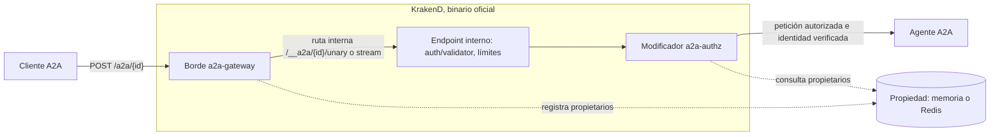

# Plugin A2A para KrakenD

[](../COPYING)


Soporte nativo del protocolo **Agent2Agent (A2A)** en el API gateway **KrakenD**, para Community 2.13.11 y Enterprise 3.0.4, con un único código fuente.

Este directorio contiene el plugin: el código, la construcción por edición, la configuración, las pruebas y las demostraciones. Esta guía explica qué soporta, cómo funciona, cómo se instala y cómo se usa. Los comandos se ejecutan desde aquí, desde `a2a-plugin`.

La presentación general del proyecto está en el [README de la raíz](../README.md).

## Contenido

- [Qué soporta](#qué-soporta)
- [Cómo funciona](#cómo-funciona)
- [Instalación](#instalación)
- [Uso](#uso)
- [Configuración](#configuración)
- [Demostraciones](#demostraciones)
- [Pruebas](#pruebas)
- [Documentación](#documentación)
- [Estructura](#estructura)
- [Limitaciones conocidas](#limitaciones-conocidas)
- [Licencia](#licencia)

## Qué soporta

### Ediciones de KrakenD

| Edición | Versión verificada | Go | Imagen de compilación | Notas |
|---|---|---|---|---|
| Community | 2.13.11 | 1.26.8 | `krakend/builder:2.13.11` | Última Community que carga plugins Go. La línea no recibe correcciones de seguridad desde el 8 de septiembre de 2026. |
| Enterprise | 3.0.4 o superior | 1.27.4 | `krakend/builder-ee:3.0.4` | Con soporte. Evita 3.0.0 a 3.0.3, que tienen un fallo en los modificadores. Requiere una licencia de Enterprise, que este repositorio no incluye. |

Cada artefacto solo carga en la edición, la versión de KrakenD, el Go y la libc exactos de su manifiesto.

### Protocolo A2A

| Versión | Binding | Estado |
|---|---|---|
| 1.0 | JSON-RPC | Completo: las once operaciones |
| 0.3 | JSON-RPC | Completo: los diez métodos |
| 1.0 y 0.3 | HTTP+JSON, gRPC | No soportados |

| A2A 1.0 | A2A 0.3 | Ruta interna |
|---|---|---|
| `SendMessage` | `message/send` | `unary` |
| `SendStreamingMessage` | `message/stream` | `stream` |
| `GetTask` | `tasks/get` | `unary` |
| `ListTasks` | No existe en 0.3 | `unary` |
| `CancelTask` | `tasks/cancel` | `unary` |
| `SubscribeToTask` | `tasks/resubscribe` | `stream` |
| `CreateTaskPushNotificationConfig` | `tasks/pushNotificationConfig/set` | `unary` |
| `GetTaskPushNotificationConfig` | `tasks/pushNotificationConfig/get` | `unary` |
| `ListTaskPushNotificationConfigs` | `tasks/pushNotificationConfig/list` | `unary` |
| `DeleteTaskPushNotificationConfig` | `tasks/pushNotificationConfig/delete` | `unary` |
| `GetExtendedAgentCard` | `agent/getAuthenticatedExtendedCard` | `unary` |

Las cuatro operaciones de notificaciones push están desactivadas por defecto, porque permiten al cliente elegir a qué destino llama el agente.

### Funciones

| Área | Qué hace el plugin |
|---|---|
| Descubrimiento | Publica la Agent Card de cada agente reescrita para que solo anuncie el gateway. La obtiene del agente, con caché, `ETag` y última copia válida, o la toma de la configuración. Verifica firmas JWS y publica los metadatos de recurso protegido (RFC 9728). |
| Protocolo | Valida el sobre JSON-RPC, negocia `A2A-Version` y encamina cada operación por el pipeline nativo de KrakenD. El streaming SSE es incremental, también en Community. |
| Control de acceso | Reutiliza la autenticación de KrakenD, añade scopes por operación, registra el propietario de cada tarea y contexto en memoria o en Redis, y bloquea webhooks hacia redes internas. |
| Operación | Valida la configuración al arrancar, aporta un esquema JSON y plantillas de Flexible Config, y produce un artefacto por edición con manifiesto y comprobación previa al despliegue. |

### Interoperabilidad verificada

| Componente | Versión |
|---|---|
| SDK oficial de A2A para Go, como cliente y como agente, en 1.0 y 0.3 | `github.com/a2aproject/a2a-go/v2` v2.8.0 |
| Firma de Agent Cards del SDK | `a2acrypto`, ES256 |
| Agentes de Pydantic AI servidos con FastA2A | FastA2A 2.1.1, Pydantic AI 2.68 |
| Redis para compartir la propiedad entre nodos | 7.4 |

## Cómo funciona

El plugin es un único `.so` con dos componentes que KrakenD carga sin modificar su binario:

| Componente | Tipo de plugin de KrakenD | Función |
|---|---|---|
| `a2a-gateway` | Servidor HTTP, `plugin/http-server` | El borde: publica las cards, valida y encamina las peticiones A2A y procesa las respuestas. |
| `a2a-authz` | Modificador de petición y respuesta, `plugin/req-resp-modifier` | Autoriza cada operación con la identidad que KrakenD ya verificó. |



Recorrido de una petición:

1. **Borde.**
   - Borra las cabeceras de identidad y las `X-A2A-*`.
   - Valida el sobre JSON-RPC y negocia la versión.
   - Identifica la operación y aplica las operaciones habilitadas y la guardia de webhooks.
   - Encamina la petición a una ruta interna.
2. **Endpoint interno de KrakenD.** La autenticación nativa valida el token y propaga la identidad. Después se aplican los demás componentes configurados, como el límite de peticiones.
3. **Autorización A2A.** El modificador `a2a-authz` comprueba la identidad obligatoria, los scopes de la operación y la propiedad de la tarea o del contexto.
4. **Agente.** Solo recibe peticiones autorizadas, con la identidad verificada en cabeceras y sin el token del cliente.
5. **Borde, en la respuesta.**
   - Registra como propietario a quien creó la tarea o el contexto.
   - Reescribe la card extendida y normaliza los errores.
   - Entrega los eventos SSE según llegan.

Rutas públicas, con los prefijos por defecto:

| Ruta | Método | Qué es |
|---|---|---|
| `/a2a/{id}` | `POST` | Endpoint JSON-RPC del agente |
| `/a2a/{id}/.well-known/agent-card.json` | `GET`, `HEAD` | Agent Card publicada |
| `/.well-known/agent-card.json` | `GET`, `HEAD` | Card del agente por defecto, si se configura `default_agent` |
| `/.well-known/oauth-protected-resource/a2a/{id}` | `GET` | Metadatos de recurso protegido (RFC 9728), si se activan |
| `/__a2a/...` | | Rutas internas. Desde fuera responden 404. |

`base_path` cambia el prefijo `/a2a` e `internal_prefix` cambia `/__a2a`.

## Instalación

Requisitos:

- Docker con Docker Compose. Los plugins `.so` se compilan siempre en Docker, con la imagen de compilación de cada edición, también desde Windows.
- Bash. En Windows sirve Git Bash.
- Go 1.26 o superior, solo para ejecutar las pruebas en el equipo local.

### 1. Construir

La construcción ejecuta todas las pruebas con el mismo Go que el binario de destino. Después, ya en la imagen oficial de KrakenD, comprueba el artefacto y la carga del plugin. Si algo falla, no se genera la imagen.

Community:

```bash
docker build -f build/community/Dockerfile -t krakend-a2a:ce-2.13.11 .
```

```bash
docker build -f build/community/Dockerfile --target artifacts -o type=local,dest=out/community .
```

Enterprise:

```bash
docker build -f build/enterprise/Dockerfile -t krakend-a2a:ee-3.0.4 .
```

```bash
docker build -f build/enterprise/Dockerfile --target artifacts -o type=local,dest=out/enterprise .
```

Para otra versión de Enterprise, pasa `--build-arg KRAKEND_VERSION=<versión>`. Debe existir la imagen `krakend/builder-ee` de esa misma versión.

Cada construcción produce tres ficheros:

| Fichero | Contenido |
|---|---|
| `krakend-a2a-<edición>-<versión>.so` | El plugin |
| `krakend-a2a-<edición>-<versión>.manifest.json` | Edición, versión de KrakenD, Go, libc, arquitectura y sha256 |
| `check-artifact.sh` | Comprobación previa al despliegue |

### 2. Comprobar en la imagen de destino

Un `.so` de otra edición o versión aborta KrakenD al cargarlo. El script lo detecta antes de desplegar:

```bash
docker run --rm --entrypoint sh -v "$PWD/out/community:/p:ro" krakend:2.13.11 /p/check-artifact.sh /p/krakend-a2a-ce-2.13.11.so
```

```bash
docker run --rm --entrypoint sh -v "$PWD/out/enterprise:/p:ro" krakend/krakend-ee:3.0.4 /p/check-artifact.sh /p/krakend-a2a-ee-3.0.4.so
```

En Enterprise, la prueba de carga del plugin necesita la licencia. Se monta en modo lectura desde fuera del repositorio:

```bash
KRAKEND_EE_LICENSE_FILE=/ruta/fuera/del/repo/LICENSE build/enterprise/plugin-test.sh krakend-a2a:ee-3.0.4
```

La imagen `krakend-a2a:ee-3.0.4` no contiene ninguna licencia.

### 3. Configurar

Lo recomendado es generar la configuración con las plantillas. Describe tus agentes en `config/templates/settings/a2a.json` y ejecuta:

```bash
config/templates/render.sh community https://gw.example.com
```

```bash
config/templates/render.sh enterprise https://gw.example.com
```

El resultado queda en `out/rendered-community.json` o en `out/rendered-enterprise.json`. Las plantillas generan dos cosas:

- El borde `a2a-gateway`.
- Por cada agente, sus endpoints internos, con la autenticación nativa, la propagación de la identidad y el modificador `a2a-authz`.

KrakenD también puede renderizar las plantillas al arrancar, como en `deploy/compose/`.

Si escribes la configuración a mano:

| | Community 2.13 | Enterprise 3.x |
|---|---|---|
| Versión del fichero | `"version": 3` | `"version": 4` |
| Bloque `plugin` | En la raíz, fuera de `extra_config` | Dentro de `extra_config` de la raíz |
| Borde | `plugin/http-server` con `"name": ["a2a-gateway"]` y el bloque A2A bajo la clave `"a2a-gateway"` | `plugin/http-server` con `"plugins": [{"name": "a2a-gateway", "config": {...}}]` |
| Cada endpoint interno | `plugin/req-resp-modifier` con `"name": ["a2a-authz"]` y `"a2a-authz": {"agent": "<id>"}` | `plugin/req-resp-modifier` con `"plugins": [{"name": "a2a-authz", "config": {"agent": "<id>"}}]` |

El bloque A2A es idéntico en las dos ediciones; ver [Configuración](#configuración).

### 4. Arrancar

Community:

```bash
docker run -p 8080:8080 -v "$PWD/out/rendered-community.json:/etc/krakend/krakend.json:ro" krakend-a2a:ce-2.13.11 run -c /etc/krakend/krakend.json
```

Enterprise, con la licencia montada en modo lectura:

```bash
docker run -p 8080:8080 \
  -e KRAKEND_LICENSE_PATH=/run/krakend-license/LICENSE \
  -v /ruta/fuera/del/repo/LICENSE:/run/krakend-license/LICENSE:ro \
  -v "$PWD/out/rendered-enterprise.json:/etc/krakend/krakend.json:ro" \
  krakend-a2a:ee-3.0.4 run -c /etc/krakend/krakend.json
```

El registro de arranque confirma que el plugin está cargado:

```
[SERVICE: Handler Plugin] Total plugins loaded: 1
[SERVICE: Modifier Plugin] Total plugins loaded: 1
[PLUGIN: a2a] versión 0.1.0 cargada con 2 agente(s)
```

Si el bloque A2A es inválido, KrakenD no arranca y el registro nombra cada campo incorrecto.

### Actualizar KrakenD Enterprise

1. Recompila el plugin con la imagen `krakend/builder-ee` de la nueva versión.
2. Ejecuta `check-artifact.sh` en la nueva imagen de KrakenD.
3. Ejecuta `plugin-test.sh` con la licencia.
4. Despliega el nuevo artefacto junto con la nueva versión de KrakenD, nunca por separado.

## Uso

Los ejemplos usan el agente `billing` publicado en `https://gw.example.com` y un token `$TOKEN` emitido por el IdP que valida KrakenD.

### Descubrir el agente

```bash
curl https://gw.example.com/a2a/billing/.well-known/agent-card.json
```

La card anuncia `https://gw.example.com/a2a/billing` y los esquemas de seguridad del gateway, nunca la URL interna del agente.

### Enviar un mensaje con A2A 1.0

```bash
curl -X POST https://gw.example.com/a2a/billing \
  -H "Authorization: Bearer $TOKEN" \
  -H "A2A-Version: 1.0" \
  -H "Content-Type: application/json" \
  -d '{"jsonrpc":"2.0","id":"1","method":"SendMessage","params":{"message":{"messageId":"m-1","role":"ROLE_USER","parts":[{"text":"hola"}]}}}'
```

La tarea que se crea queda registrada a nombre de quien la creó. Si otro usuario pide esa tarea con `GetTask`, recibe `-32001 Task not found`, igual que si no existiera.

### Recibir la respuesta en streaming

```bash
curl -N -X POST https://gw.example.com/a2a/billing \
  -H "Authorization: Bearer $TOKEN" \
  -H "A2A-Version: 1.0" \
  -H "Content-Type: application/json" \
  -d '{"jsonrpc":"2.0","id":"2","method":"SendStreamingMessage","params":{"message":{"messageId":"m-2","role":"ROLE_USER","parts":[{"text":"hola"}]}}}'
```

Los eventos `data:` llegan según los emite el agente.

### Clientes de A2A 0.3

Una petición sin la cabecera `A2A-Version` se atiende como 0.3, con los nombres de método antiguos. El agente debe tener `"versions": ["1.0", "0.3"]`.

```bash
curl -X POST https://gw.example.com/a2a/billing \
  -H "Authorization: Bearer $TOKEN" \
  -H "Content-Type: application/json" \
  -d '{"jsonrpc":"2.0","id":"3","method":"message/send","params":{"message":{"kind":"message","messageId":"m-3","role":"user","parts":[{"kind":"text","text":"hola"}]}}}'
```

### Con el SDK oficial de Go

Cada agente se publica bajo su propia ruta. El resolutor del SDK usa como URL de la card cualquier URL que tenga ruta, así que hay que darle la URL completa:

```go
card, err := agentcard.DefaultResolver.Resolve(ctx, "https://gw.example.com/a2a/billing/.well-known/agent-card.json")
```

Con solo el dominio, el resolutor obtiene la card del agente por defecto, si está configurado.

### Respuestas de error

| Situación | Respuesta |
|---|---|
| Sin token o sin identidad | HTTP 401 con `WWW-Authenticate` |
| Falta un scope de `operation_scopes` | HTTP 403 |
| Agente no configurado, o ruta interna pedida desde fuera | HTTP 404 |
| Método HTTP distinto de `POST` en el endpoint del agente | HTTP 405 |
| Cuerpo mayor que `limits.max_body_bytes` | HTTP 413 |
| Cuerpo que no es UTF-8 válido o JSON bien formado | `-32700 Parse error` |
| Sobre JSON-RPC inválido, por ejemplo sin `id` o en lote | `-32600 Invalid Request` |
| Método desconocido | `-32601 Method not found` |
| URL de webhook rechazada por la guardia | `-32602` |
| Versión de A2A no habilitada para el agente | `-32009 Version not supported` |
| Operación desactivada en `disabled_operations`, o streaming desactivado para el agente | `-32004 Unsupported operation` |
| Notificaciones push desactivadas para el agente | `-32003 Push notifications are not supported` |
| Tarea o contexto de otro usuario, o sin propietario registrado | `-32001 Task not found` |
| Almacén de propiedad caído, con `on_store_error` a `deny` | `-32603 Internal error` |

### Qué recibe el agente

| Recibe | No recibe |
|---|---|
| El cuerpo JSON-RPC sin cambios | El token del cliente |
| `A2A-Version` y `A2A-Extensions` | Las cabeceras `X-A2A-*` que envíe el cliente |
| La identidad verificada, en las cabeceras de `identity.headers` | |
| `X-A2A-Operation`, `X-A2A-Agent`, `X-A2A-Version` y `X-A2A-Request-Id` | |

Un agente puede confiar en las cabeceras de identidad solo si es accesible únicamente a través del gateway.

## Configuración

El plugin se configura con un único bloque JSON, idéntico en las dos ediciones. El bloque mínimo publica un agente cuya card se obtiene del propio agente:

```json
{
  "public_url": "https://gw.example.com",
  "agents": [
    {
      "id": "billing",
      "card": { "source": "upstream", "url": "http://billing.internal:8080/.well-known/agent-card.json" }
    }
  ]
}
```

| Campo | Para qué sirve |
|---|---|
| `public_url` | URL con la que los clientes ven el gateway. Las cards publicadas la anuncian. |
| `base_path`, `internal_prefix` | Prefijos de las rutas públicas e internas |
| `route_granularity` | Rutas internas por clase (`class`) o por operación (`operation`) |
| `default_agent` | Agente cuya card se publica también en la raíz |
| `limits` | Tamaño máximo de las peticiones y de las respuestas inspeccionadas |
| `identity` | Cabeceras con la identidad que propaga KrakenD y clave de propietario |
| `authorization` | Scopes que exige cada operación |
| `ownership` | Control de propiedad: almacén, TTL y políticas de tareas desconocidas, `ListTasks` y almacén caído |
| `push_notifications` | Guardia de webhooks |
| `challenge` | Respuesta 401 y metadatos de recurso protegido |
| `agents` | Agentes publicados: origen y firma de la card, versiones, seguridad, capacidades y operaciones desactivadas |

El plugin valida el bloque al arrancar:

- Rechaza los campos desconocidos y los valores `null`.
- Comprueba rangos y reglas entre campos.
- Con un solo error, KrakenD no arranca, y el mensaje lista todos los errores con la ruta de cada campo.

Algunas combinaciones válidas pero arriesgadas generan un aviso en el registro, como `public_url` con `http` o la propiedad en memoria.

Referencias:

- La de cada campo, con tipos, valores por defecto y reglas, está en [docs/configuracion.md](docs/configuracion.md).
- El esquema JSON es [`config/schema/a2a-gateway.schema.json`](config/schema/a2a-gateway.schema.json).
- Hay ejemplos válidos e inválidos en [`config/examples/`](config/examples). El más completo es [`config/examples/valid/complete.json`](config/examples/valid/complete.json).

## Demostraciones

### Community

```bash
docker compose -f deploy/compose/community.yml up -d --build
```

```bash
bash deploy/demo.sh ce
```

El entorno contiene:

- Dos nodos de KrakenD con el plugin, que comparten Redis.
- Un IdP simulado.
- Dos agentes hechos con el SDK oficial: `billing` y `research`, que firma su card.

`demo.sh` recorre diez pasos:

1. Tokens del IdP.
2. Descubrimiento.
3. `SendMessage` en 1.0.
4. Streaming.
5. Otro usuario no puede leer una tarea ajena.
6. La propiedad se respeta entre los dos nodos.
7. Una petición sin token recibe 401.
8. Un cliente 0.3 funciona.
9. Un webhook hacia la red interna se bloquea.
10. Se verifica la firma de la card.

| Puerto | Servicio |
|---|---|
| 18080 y 18081 | Nodos del gateway |
| 18090 | IdP simulado |
| 18091 y 18092 | Administración de los agentes `billing` y `research` |

El primer arranque genera las claves y los secretos de la demostración en `deploy/.secrets`, que git excluye. Para rotarlos, borra ese directorio y vuelve a levantar el entorno.

### Enterprise

Necesitas tu propia licencia de KrakenD Enterprise. Se monta en modo lectura desde una ruta fuera del repositorio:

```bash
KRAKEND_EE_LICENSE_FILE=/ruta/fuera/del/repo/LICENSE docker compose -f deploy/compose/enterprise.yml up -d --build
```

```bash
bash deploy/demo.sh ee
```

Usa los puertos 28080 a 28092. Los registros de Enterprise incluyen líneas sobre la licencia, así que fíltralos antes de compartirlos.

### Agentes de Pydantic AI

Dos agentes de Pydantic AI que hablan A2A a través del gateway. El coordinador consulta al agente de soporte en streaming, con su propio token:

```bash
cd demos/pydantic-ai
docker compose up -d --build
docker compose run --rm pruebas
```

Las pruebas hacen 27 comprobaciones. Sin credenciales, los agentes usan un modelo local y determinista. Con `ANTHROPIC_API_KEY` definida usan Claude Opus 5.5. Detalles en [su README](demos/pydantic-ai/README.md).

## Pruebas

| Nivel | Comando | Qué necesita |
|---|---|---|
| Núcleo y adaptador | `cd core && go test ./...` y `cd plugin && go test ./...` | Go 1.26 o superior |
| Esquema, ejemplos y documentación | `cd config/conformance && go test ./...` | Go |
| Redis real | `A2A_TEST_REDIS=host:puerto go test -run TestRedisStore ./ownership/` en `core` | Un Redis |
| Plantillas con KrakenD real | `bash config/templates/render.sh community` y `enterprise` | Docker |
| Extremo a extremo | `A2A_EDITION=ce go test ./...` en `e2e`, o `A2A_EDITION=ee` | El entorno de `deploy/compose` levantado |
| Carga | `bash e2e/load.sh ce 30s` | El entorno de `deploy/compose` levantado |
| Agentes de Pydantic AI | `docker compose run --rm pruebas` en `demos/pydantic-ai` | Su entorno levantado |
| Integración continua completa | `bash scripts/ci.sh` | Docker; licencia de Enterprise opcional |

Estado verificado en las dos ediciones; la última ronda completa fue el 20 de noviembre de 2026:

- **Pruebas unitarias.** Se ejecutan con Go 1.26.8 y 1.27.4, los de cada edición.
- **Artefactos.** Pasan la comprobación de compatibilidad y la de carga de KrakenD, y cada edición rechaza el artefacto de la otra.
- **Extremo a extremo.** 8 de 8 pruebas con KrakenD real y el SDK oficial, en A2A 1.0 y 0.3, incluido el control de propiedad entre dos nodos.
- **Carga.** 30 segundos con 16 clientes y dos nodos, todas las respuestas correctas: 77 058 peticiones en Community y 2 941 en Enterprise. La diferencia no la causa el plugin: Enterprise 3.0.4 sin el plugin rinde igual en la misma máquina.
- **Pydantic AI.** 27 de 27 comprobaciones, solo en Community.
- **Análisis estático.** SonarQube, con todas las reglas de Go y de Dockerfile activas: sin incidencias ni hotspots de seguridad.

## Documentación

| Documento | Contenido |
|---|---|
| [docs/configuracion.md](docs/configuracion.md) | Referencia del bloque de configuración |
| [docs/seguridad.md](docs/seguridad.md) | Modelo de seguridad y límites |
| [docs/community.md](docs/community.md) | Instalación en Community 2.13 y aviso de soporte |
| [docs/enterprise.md](docs/enterprise.md) | Instalación en Enterprise 3.0 |
| [docs/compatibilidad.md](docs/compatibilidad.md) | Versiones verificadas |
| [docs/desarrollo.md](docs/desarrollo.md) | Desarrollo, pruebas, SonarQube y licencia de Enterprise |
| [docs/validacion-supuestos.md](docs/validacion-supuestos.md) | Resultados de la fase 0 |

## Estructura

| Ruta | Contenido |
|---|---|
| `core/` | Núcleo independiente de la edición, solo biblioteca estándar |
| `plugin/` | Adaptador de plugin único para las dos ediciones |
| `build/` | Construcción por edición y comprobación de artefactos |
| `config/` | Esquema JSON, ejemplos, plantillas y pruebas de conformidad |
| `deploy/` | IdP simulado, agente de referencia del SDK oficial, Compose y `demo.sh` |
| `demos/pydantic-ai/` | Demostración con dos agentes de Pydantic AI que hablan A2A a través del gateway |
| `e2e/` | Pruebas de extremo a extremo con el SDK oficial y prueba de carga |
| `docs/` | Configuración, seguridad, instalación, compatibilidad y desarrollo |
| `prototype/` | Prototipo desechable de la fase 0 |
| `scripts/ci.sh` | Integración continua completa |
| `scripts/sonar.sh` | Análisis local con SonarQube |

El diseño y las especificaciones están en [`openspec/changes/add-a2a-gateway-plugin/`](../openspec/changes/add-a2a-gateway-plugin), en la raíz del repositorio.

## Limitaciones conocidas

- **Bindings.** Solo JSON-RPC. HTTP+JSON y gRPC no están soportados.
- **Community.** Community 3.x no carga plugins Go, y Community 2.13 no recibe correcciones de seguridad. No la expongas directamente a internet.
- **Enterprise.** Las versiones 3.0.0 a 3.0.3 tienen un fallo en los modificadores. Cada versión de Enterprise necesita su propio artefacto.
- **Redis.** Admite un único servidor o un punto de entrada único, con autenticación y TLS. No admite Redis Cluster ni Sentinel.
- **Arquitectura.** Solo se ha verificado en amd64.
- **Licencias de Enterprise sin el módulo AI Gateway.** No se ha comprobado que el plugin cargue con ellas.
- **Webhooks.** La guardia es defensa en profundidad: quien llama al webhook es el agente, así que su red también debe limitar las salidas.
- **`ListTasks`.** Depende de que el agente la implemente; FastA2A, por ejemplo, no lo hace.

## Licencia

Licencia MIT; ver [COPYING](../COPYING) en la raíz del repositorio. Puedes usar, modificar y distribuir el plugin libremente, también en proyectos comerciales y en forks, conservando el aviso de copyright y de licencia.

La licencia cubre el código de este repositorio:

- KrakenD Community se distribuye con su propia licencia, Apache 2.0.
- KrakenD Enterprise requiere una licencia comercial, que este repositorio no incluye.
